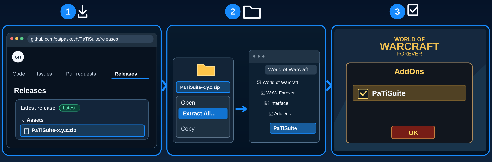

# PaTiSuite

## What is PaTiSuite?

A tiny, optional control panel for World of Warcraft: Forever (Interface 16001): one line per installed PaTi addon
to show or hide its window, plus **Show all** / **Hide all**. It is a remote control, nothing more — every PaTi addon
works exactly the same without it.

> Status: 0.1.0, in development, not yet released. Partly tested in game ([`INGAME_TESTING.md`](INGAME_TESTING.md)).

## Features

- Lists the PaTi addons that are installed and running (Heal, Auras, Aggro, Rota, Group, Lead, Quest, Dungeon, Social,
  Alerts) in a compact panel: a coloured dot and the short name — green = window shown, grey = hidden. A click on an entry
  shows or hides that window
- One button for all windows: "Hide all" while every window is shown, otherwise "Show all"; the control panel
  itself stays visible
- Respects each addon's rules: windows with secure buttons (Heal, Auras, Rota, Lead) cannot be shown or hidden in combat —
  PaTiSuite then says so (e.g. "Heal: not possible in combat") and changes nothing
- Layout: vertical (one entry per line, button below, default) or horizontal (side by side, the button as the
  last element of the row; wraps only when the screen is too narrow) — Settings → Display → Layout, at once
- Remembers what you show or hide here: after `/reload` every window you switched in PaTiSuite is as you left it.
  Windows you never switched here start as their addon starts them. Restore Defaults forgets this
- ••• menu: Settings, Lock, Collapse/Expand (only the header stays), Reset position, Hide. Settings: language,
  scale, lock, panel opacity, layout

No test mode: the panel only shows your real windows, there is nothing to simulate.

## Installation

1. 📥 **Download** – Open [GitHub Releases](https://github.com/patpaskoch/PaTiSuite/releases) and download the `PaTiSuite-<version>.zip` file under **Assets** (not **Source code (zip)**).
2. 📂 **Extract & Copy** – Right-click the ZIP, select **Extract All**, then copy the extracted `PaTiSuite` folder into the WoW Forever client's `Interface/AddOns/` folder. No renaming is needed.
3. ☑️ **Enable in Game** – Start WoW, open the **AddOns** menu at character selection, tick **PaTiSuite**, and click **OK**.

**Optional:** Install the other PaTi addons you want to control; they also work without PaTiSuite.

## Getting Started

- Type `/psuite` to open or hide the control panel.
- Click an installed PaTi addon's entry to show or hide its window; the other addons remain independent.

## Settings

Open `/psuite settings` or the panel's menu to adjust the control panel. Use `/psuite lock` or `/psuite unlock` for window movement.

## Supported PaTi addons

PaTiSuite is optional and only a control panel. No other addon needs it; every PaTi addon works on its own, with or without it. It lists whichever of these are installed:

- **PaTiSuite** – optional control panel to show and hide the PaTi windows *(this addon)*
- [PaTiHeal](https://github.com/patpaskoch/PaTiHeal) – healing: party frames, heal target, click casting, HoTs, dispels
- [PaTiAuras](https://github.com/patpaskoch/PaTiAuras) – buffs, procs, tracking, group buffs and weapon imbues
- [PaTiAggro](https://github.com/patpaskoch/PaTiAggro) – aggro for tank, healer and damage (formerly PaTiTank)
- [PaTiRota](https://github.com/patpaskoch/PaTiRota) – your own skill priority with cooldowns and fixed cast buttons
- [PaTiGroup](https://github.com/patpaskoch/PaTiGroup) – party awareness: tank, healer, roles and the tank's target
- [PaTiLead](https://github.com/patpaskoch/PaTiLead) – lead the group: raid markers, ready check and pull timer
- [PaTiQuest](https://github.com/patpaskoch/PaTiQuest) – selected quest and its objectives
- [PaTiDungeon](https://github.com/patpaskoch/PaTiDungeon) – instance, group and combat status
- [PaTiSocial](https://github.com/patpaskoch/PaTiSocial) – "Party Social": quick emote and message buttons
- [PaTiAlerts](https://github.com/patpaskoch/PaTiAlerts) – one window for open problems

## Commands

`/psuite` or `/patisuite` — alone: show/hide the panel · `showall` · `hideall` · `show` · `hide` · `lock` · `unlock` ·
`reset` (position) · `settings` · `debug` · `version`

## How it finds the windows

Every PaTi addon's window registers itself in a small shared list (`PaTiSuiteWindows`: addon name → window frame,
nothing else). PaTiSuite reads that list; it never reads settings or game data of other addons.

## Known limitations

- In-game test status: [`INGAME_TESTING.md`](INGAME_TESTING.md) (the single "all" button is not tested yet).

## Development

Architecture, tests and engineering rules of the suite: [PaTiAdmin](https://github.com/patpaskoch/PaTiAdmin). PaTiAdmin is not a WoW addon — players do not install it. The shared UI code (PaTiShared) is already embedded in this addon's `Shared/` folder; there is nothing extra to install.

## Support

PaTiSuite is free and open source, and it stays that way. If it makes your runs a bit better, you can buy me a coffee:
[ko-fi.com/patiaddons](https://ko-fi.com/patiaddons). Bug reports and ideas are just as welcome:
[Issues](https://github.com/patpaskoch/PaTiSuite/issues).

## License

MIT — see [LICENSE](LICENSE). Copyright (c) 2026 Patrick Koch.
